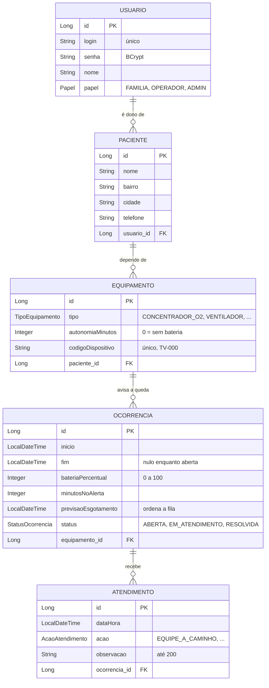

# API Tomada Vital

API REST em Spring Boot que recebe o aviso de queda de energia na casa de quem depende de um aparelho elétrico para viver, calcula quanto tempo a bateria do aparelho ainda aguenta e monta a **fila de atendimento da concessionária: quem tem menos bateria é atendido primeiro**.

Projeto da **Global Solution 2026/2 (FIAP)**, tema CitizenTech, disciplina **Java Advanced**.

------------------------------------------------------------------------

## Sumário

1. [O problema](#1-o-problema)
2. [A solução e o papel desta API](#2-a-solução-e-o-papel-desta-api)
3. [Integrantes](#3-integrantes)
4. [Vídeo pitch](#4-vídeo-pitch)
5. [Tecnologias](#5-tecnologias)
6. [Como rodar](#6-como-rodar)
7. [Usuários de teste](#7-usuários-de-teste)
8. [Como autenticar (JWT)](#8-como-autenticar-jwt)
9. [Diagrama das entidades](#9-diagrama-das-entidades)
10. [Como os relacionamentos foram modelados](#10-como-os-relacionamentos-foram-modelados)
11. [A regra de prioridade](#11-a-regra-de-prioridade)
12. [Endpoints](#12-endpoints)
13. [Consultas e por que cada tipo](#13-consultas-e-por-que-cada-tipo)
14. [Cache](#14-cache)
15. [HATEOAS](#15-hateoas)
16. [Actuator](#16-actuator)
17. [Erros](#17-erros)
18. [Estrutura de pastas](#18-estrutura-de-pastas)

------------------------------------------------------------------------

## 1. O problema

Muita gente depende, em casa, de um aparelho elétrico para continuar viva: **concentrador de oxigênio, ventilador pulmonar, aspirador de secreção, bomba de infusão**. Quando a luz cai, o aparelho passa a funcionar só com a bateria (quando tem bateria). Se a energia não volta a tempo, a bateria acaba e o paciente fica sem o aparelho.

E a luz tem caído por muito tempo na Grande São Paulo:

- **Apagão de 10/12/2025 em São Paulo:** a Enel admitiu **4,4 milhões de clientes atingidos**. *(Fonte: Mercado & Consumo, 14/01/2026)*
- **Temporal de 11/10/2024:** **2,1 milhões de casas** ficaram sem energia; em **Taboão da Serra**, **32,7 mil instalações** ainda estavam sem luz no **3º dia**. *(Fonte: Brasil de Fato, via CUT)*
- A **ANEEL** prevê prioridade no atendimento para quem depende de aparelho elétrico, mas **só para quem está cadastrado antes** na distribuidora. *(Fonte: regra da ANEEL, A Gazeta do Acre, 03/2024)*

Quando o apagão atinge milhões de casas ao mesmo tempo, a concessionária não sabe **quais** casas têm alguém dependendo de um aparelho, nem **quanto tempo** cada uma ainda tem. A família, por sua vez, não sabe se alguém já está a caminho.

------------------------------------------------------------------------

## 2. A solução e o papel desta API

A **Tomada Vital** é um dispositivo ligado na tomada do aparelho. Quando percebe a queda de energia, ele manda pela **rede celular** (o Wi-Fi da casa apaga junto) o código do dispositivo e a porcentagem de bateria do aparelho naquele momento.

> **O dispositivo mede a tomada, nunca o paciente.** Não é um aparelho médico. O único dado de saúde guardado é "usa equipamento vital" e a autonomia da bateria do aparelho.

**Esta API é o centro do sistema:**

```text
 Dispositivo Tomada Vital (IoT, na tomada)
        │  rede celular: { "codigoDispositivo": "TV-001", "bateriaPercentual": 20 }
        ▼
 ┌───────────────────────────────────────┐
 │  API Tomada Vital (este repositório)  │  registra a queda, calcula os minutos
 │  Spring Boot + JWT                    │  restantes e monta a fila por bateria
 └───────────────────────────────────────┘
        │                         │
        ▼                         ▼
 App da família (Flutter)    Fila do operador da concessionária
 acompanha a ocorrência      atende quem tem menos bateria primeiro
```

O mesmo projeto aparece nas outras disciplinas da Global Solution:

| Parte do ecossistema | O que faz |
|---|---|
| Dispositivo IoT | percebe a queda na tomada e avisa pela rede celular |
| **API Java (esta)** | recebe a queda, calcula a prioridade, monta a fila, registra o atendimento |
| App Mobile (Flutter) | a família cadastra o paciente e os aparelhos e acompanha a ocorrência; consome esta API |
| Banco Oracle / PL-SQL | o mesmo modelo de dados e a mesma regra de prioridade, no Oracle |
| API .NET | os pontos de apoio (locais com gerador para onde o paciente pode ser levado) |
| DevOps | esta API rodando no **Azure** com Docker e MySQL (perfil `docker`) |

**ODS da ONU atendidos:** **3** (Saúde e bem-estar) · **9** (Indústria, inovação e infraestrutura) · **11** (Cidades e comunidades sustentáveis) · **13** (Ação contra a mudança global do clima: adaptação aos temporais extremos que causam os apagões longos).

------------------------------------------------------------------------

## 3. Integrantes

| Nome | RM | Turma | Matéria |
|---|---|---|---|
| Diego Paulino | RM566841 | 2TDSPR | Java Advanced (esta API) |
| Ryan <!-- PREENCHER --> | <!-- PREENCHER --> | <!-- PREENCHER --> | Mobile (app Flutter) |
| Guilherme <!-- PREENCHER --> | <!-- PREENCHER --> | <!-- PREENCHER --> | <!-- PREENCHER --> |
| Thiago <!-- PREENCHER --> | <!-- PREENCHER --> | <!-- PREENCHER --> | DevOps (Azure e Docker) |
| Renan <!-- PREENCHER --> | <!-- PREENCHER --> | <!-- PREENCHER --> | <!-- PREENCHER --> |

------------------------------------------------------------------------

## 4. Vídeo pitch

Link: <!-- PREENCHER -->

------------------------------------------------------------------------

## 5. Tecnologias

| Tecnologia | Para quê |
|---|---|
| Java 25 | linguagem |
| Spring Boot 4.1.2 | base da aplicação |
| Maven Wrapper (`mvnw`) | compila e roda sem precisar instalar o Maven |
| Spring Web (`spring-boot-starter-webmvc`) | os endpoints REST |
| Spring Data JPA | entidades, relacionamentos e repositórios (query methods, JPQL e Specification) |
| Bean Validation | validação dos dados de entrada (`@NotBlank`, `@Min`, `@Max`, `@Pattern`, `@Size`) |
| Spring Security + OAuth2 Resource Server | login por HTTP Basic, Token JWT (HS256), autorização por papel e CORS |
| Spring Cache | cache em memória das consultas por id de pacientes e equipamentos |
| Spring HATEOAS | respostas em HAL com links `self`, relacionados e de ação |
| Spring Boot Actuator | `health`, `info` e `metrics` |
| springdoc-openapi 3.1.0 | documentação Swagger / OpenAPI |
| H2 (em arquivo) | banco do perfil `dev` (o padrão) |
| MySQL Connector | banco do perfil `docker` (entrega de DevOps) |
| JUnit | testes da regra de prioridade |

------------------------------------------------------------------------

## 6. Como rodar

### Pré-requisitos

- **Java 25** (JDK) no PATH. Confira com `java -version`.
- **Git**.
- **Não precisa instalar o Maven:** o projeto traz o Maven Wrapper (`mvnw`), que baixa o Maven e as dependências na primeira execução (precisa de internet nessa primeira vez).

### Passo a passo

```bash
git clone https://github.com/DiegoCPaulino/API-Tomada-Vital.git
cd API-Tomada-Vital
```

Linux, macOS ou Git Bash:

```bash
./mvnw spring-boot:run
```

Windows PowerShell:

```powershell
.\mvnw.cmd spring-boot:run
```

A API sobe na porta **8080** com o perfil `dev` (banco H2 em arquivo, na pasta `data/`). Na primeira vez, a classe `CargaInicialRunner` grava os dados de teste e o log mostra:

```text
Carga inicial: 12 usuários, 10 pacientes, 11 equipamentos, 10 ocorrências, 10 atendimentos
```

Espere essa linha antes de testar: a carga roda logo depois de o servidor começar a responder. Nas próximas vezes o log mostra `Carga inicial já existente` (os dados não são gravados de novo).

Para parar: `Ctrl + C` no terminal.

### Endereços

| O quê | Endereço |
|---|---|
| Swagger (testar todos os endpoints) | http://localhost:8080/swagger-ui/index.html |
| Documento OpenAPI | http://localhost:8080/v3/api-docs |
| Console do H2 (só no perfil `dev`) | http://localhost:8080/h2-console — JDBC URL `jdbc:h2:file:./data/tomada-vital-db;AUTO_SERVER=TRUE`, usuário `sa`, senha em branco |
| Actuator | http://localhost:8080/actuator/health · http://localhost:8080/actuator/info · http://localhost:8080/actuator/metrics (só ADMIN) |

### Voltar aos dados originais

As 7 ocorrências abertas da carga começam "alguns minutos antes" do momento em que a aplicação sobe pela primeira vez. Com o passar do tempo, os minutos de bateria vão diminuindo (é o comportamento esperado). Para voltar aos valores originais (por exemplo, antes de uma demonstração):

1. pare a aplicação;
2. apague a pasta `data/` na raiz do projeto;
3. suba de novo. A carga roda outra vez.

### Perfil `docker` (MySQL)

É o perfil usado na entrega de DevOps (a API com Docker no Azure). Ele troca o H2 pelo MySQL e lê tudo de variáveis de ambiente:

| Variável | Para quê |
|---|---|
| `SPRING_PROFILES_ACTIVE` | `docker` |
| `SPRING_DATASOURCE_URL` | endereço do MySQL, no formato `jdbc:mysql://<host>:3306/<banco>` |
| `SPRING_DATASOURCE_USERNAME` | usuário do banco |
| `SPRING_DATASOURCE_PASSWORD` | senha do banco |
| `JWT_SECRET` | segredo que assina o token (texto com 32 caracteres ou mais). **Obrigatório:** sem ele a aplicação não sobe |

No perfil `dev` o segredo do token é um texto de exemplo, que fica no `application.properties`. Nenhuma senha ou chave real está no repositório.

------------------------------------------------------------------------

## 7. Usuários de teste

A carga inicial cria 12 usuários. **A senha de todos é `123456`.**

| Login | Papel | Quem é | O que pode fazer |
|---|---|---|---|
| `familia1` | FAMILIA | família da **Maria Aparecida Souza** (paciente 1, aparelhos TV-001 e TV-002) | cadastrar, alterar e apagar os **seus** pacientes e equipamentos; avisar uma queda nos seus aparelhos; acompanhar as **suas** ocorrências e atendimentos |
| `familia2` | FAMILIA | família do **José Carlos Lima** (paciente 2, aparelho TV-003) | o mesmo, só para os seus. Serve para testar o 403 ao pedir dados da `familia1` |
| `familia3` … `familia10` | FAMILIA | a família do paciente de mesmo número | o mesmo, só para os seus |
| `operador` | OPERADOR | a central da concessionária | ver pacientes, equipamentos e ocorrências de **todos**; ver a **fila**; registrar atendimentos e resolver ocorrências |
| `admin` | ADMIN | administrador | tudo, inclusive alterar e apagar dados de qualquer família e ver as métricas do Actuator |

Uma família nova também pode se cadastrar em `POST /autenticacao/cadastro` (sempre com o papel FAMILIA).

------------------------------------------------------------------------

## 8. Como autenticar (JWT)

### O fluxo, do login à requisição protegida

1. **Login:** o cliente (app, Swagger ou curl) chama `POST /autenticacao/login` com o cabeçalho `Authorization: Basic base64(login:senha)`, sem corpo.
2. **Conferência da senha:** o Spring Security passa o login para o `UsuarioDetailsService`, que busca o usuário **no banco**. O `DaoAuthenticationProvider` compara a senha digitada com a senha guardada em **BCrypt**. Se não bater: **401**.
3. **Geração do token:** o `GeradorTokenJWTService` monta o token com `iss = api-tomada-vital`, `sub = login`, `iat`, `exp` (+3600 s) e o claim `roles` com o papel (`ROLE_FAMILIA`, `ROLE_OPERADOR` ou `ROLE_ADMIN`), e assina com **HS256**. A resposta é o `TokenResponse`. O token vale **1 hora**, para o app não pedir login à família a toda hora.
4. **Requisição protegida:** nas demais chamadas, o cliente manda `Authorization: Bearer <accessToken>`. O `JwtDecoder` confere a assinatura e a validade (token inválido ou vencido: **401**), o `JwtAuthenticationConverter` lê o claim `roles`, e a `ConfiguracoesDeSeguranca` aplica as regras por URL e método (`hasRole` / `hasAnyRole`; papel errado: **403**). Por último, o `ControleDeAcesso` confere se o registro é da família logada (de outra família: **403**).

Resposta real do login (`familia1`, token encurtado):

```json
{ "accessToken": "eyJraWQiOiJWbE92ekZw...", "tokenType": "Bearer", "expiresIn": 3600 }
```

O que vai dentro do token (payload decodificado, real):

```json
{"iss":"api-tomada-vital","sub":"familia1","exp":1794335753,"iat":1794332153,"roles":["ROLE_FAMILIA"]}
```

### Pelo Swagger

1. Abra http://localhost:8080/swagger-ui/index.html e clique em **Authorize**.
2. Em **basicAuth**, digite o login e a senha (ex.: `operador` / `123456`) e clique em *Authorize* e depois em *Close*.
3. Em **Autenticação**, abra `POST /autenticacao/login`, clique em *Try it out* e *Execute*. Copie o valor de `accessToken` da resposta.
4. Clique de novo em **Authorize**, cole o token em **bearerAuth** e clique em *Authorize*. Pronto: os demais endpoints já vão com o token.

### Por curl

Os exemplos abaixo são para **Git Bash, Linux ou macOS** (no PowerShell, prefira o Swagger).

```bash
# 1. login: guarda o accessToken numa variável (troque operador por familia1, admin...)
TOKEN=$(curl -s -u operador:123456 -X POST http://localhost:8080/autenticacao/login | sed -E 's/.*"accessToken":"([^"]+)".*/\1/')

# 2. requisição protegida: a fila de atendimento
curl -H "Authorization: Bearer $TOKEN" http://localhost:8080/api/ocorrencias/fila
```

Um roteiro completo, do cadastro ao atendimento (com os dados recém-carregados):

```bash
# cadastro público de uma família nova -> 201, papel FAMILIA
curl -X POST http://localhost:8080/autenticacao/cadastro -H "Content-Type: application/json" \
  -d '{"nome":"Familia de Ana Lima","login":"ana.lima","senha":"123456"}'

# a familia1 avisa uma queda no aspirador TV-002 com 50% de bateria
# -> 201: 240 min x 50% = 120 min, CRITICA (120 ainda é crítica), status ABERTA
FAMILIA=$(curl -s -u familia1:123456 -X POST http://localhost:8080/autenticacao/login | sed -E 's/.*"accessToken":"([^"]+)".*/\1/')
curl -X POST http://localhost:8080/api/ocorrencias -H "Authorization: Bearer $FAMILIA" -H "Content-Type: application/json" \
  -d '{"codigoDispositivo":"TV-002","bateriaPercentual":50}'

# a família só vê o que é dela: só a Maria
curl -H "Authorization: Bearer $FAMILIA" http://localhost:8080/api/pacientes

# a família não vê a fila da central -> 403
curl -i -H "Authorization: Bearer $FAMILIA" http://localhost:8080/api/ocorrencias/fila

# o operador inicia o atendimento da ocorrência 2 (José, ABERTA) -> 201; ela passa a EM_ATENDIMENTO
TOKEN=$(curl -s -u operador:123456 -X POST http://localhost:8080/autenticacao/login | sed -E 's/.*"accessToken":"([^"]+)".*/\1/')
curl -X POST http://localhost:8080/api/ocorrencias/2/atendimentos -H "Authorization: Bearer $TOKEN" -H "Content-Type: application/json" \
  -d '{"acao":"EQUIPE_A_CAMINHO","observacao":"Equipe saiu da base"}'

# a energia voltou: o operador resolve a ocorrência 2 -> 200, RESOLVIDA
curl -X POST http://localhost:8080/api/ocorrencias/2/resolver -H "Authorization: Bearer $TOKEN" -H "Content-Type: application/json" \
  -d '{"observacao":"Rede religada"}'

# a linha do tempo da ocorrência 2: EQUIPE_A_CAMINHO e ENERGIA_RESTABELECIDA
curl -H "Authorization: Bearer $TOKEN" http://localhost:8080/api/ocorrencias/2/atendimentos

# filtro dinâmico: as ocorrências abertas que ficam sem bateria em até 120 minutos
curl -H "Authorization: Bearer $TOKEN" "http://localhost:8080/api/ocorrencias?status=ABERTA&minutosMaximos=120"
```

> No Git Bash do Windows, texto com acento digitado direto no `-d` do curl não sai em UTF-8 e a API responde 400. Por isso os exemplos estão sem acento. Pelo Swagger ou pelo app, os acentos funcionam normalmente.

------------------------------------------------------------------------

## 9. Diagrama das entidades



Todas as entidades estendem a `EntidadeBase` (`@MappedSuperclass`), que acrescenta `cadastradoEm` e `atualizadoEm` (preenchidos por `@PrePersist` e `@PreUpdate`). O id de cada uma sai de uma sequence própria (`@SequenceGenerator`, `allocationSize = 1`).

------------------------------------------------------------------------

## 10. Como os relacionamentos foram modelados

O modelo é uma corrente de relações **1:N**: `USUARIO 1──N PACIENTE 1──N EQUIPAMENTO 1──N OCORRENCIA 1──N ATENDIMENTO`.

| Relação | Lado "muitos" (dono da FK) | Lado "um" | Fetch | Cascade |
|---|---|---|---|---|
| Usuário → Paciente | `Paciente.usuario`: `@ManyToOne` + `@JoinColumn(name = "usuario_id", nullable = false)` | `Usuario.pacientes`: `@OneToMany(mappedBy = "usuario")` | LAZY | nenhum |
| Paciente → Equipamento | `Equipamento.paciente` (`paciente_id`) | `Paciente.equipamentos` (`mappedBy = "paciente"`) | LAZY | nenhum |
| Equipamento → Ocorrência | `Ocorrencia.equipamento` (`equipamento_id`) | `Equipamento.ocorrencias` (`mappedBy = "equipamento"`) | LAZY | nenhum |
| Ocorrência → Atendimento | `Atendimento.ocorrencia` (`ocorrencia_id`) | `Ocorrencia.atendimentos` (`mappedBy = "ocorrencia"`) | LAZY | **PERSIST, MERGE, REMOVE** |

**FK do lado "muitos".** Num 1:N a chave estrangeira fica sempre na tabela do lado "muitos": cada equipamento aponta para o seu paciente (`paciente_id`), e não o contrário (um paciente não teria como guardar vários ids numa coluna só). Por isso o `@JoinColumn` está no `@ManyToOne`, e o lado `@OneToMany` usa `mappedBy` para dizer "quem manda nesta relação é o atributo do outro lado". O `nullable = false` impede, no banco, um equipamento sem paciente.

**Fetch LAZY em todo `@ManyToOne`.** O padrão do JPA para `@ManyToOne` é EAGER: carregar uma ocorrência traria junto o equipamento, o paciente e o usuário, mesmo quando ninguém vai usar. Com LAZY, o relacionado só é buscado quando o código chama o `get`. Quando a consulta **sabe** que vai precisar (a fila mostra o nome e o bairro do paciente de cada ocorrência), ela usa `JOIN FETCH` e traz tudo numa consulta só (ver [Consultas](#13-consultas-e-por-que-cada-tipo)).

**Por que o cascade só em Ocorrência → Atendimento.** O atendimento **não existe sem a ocorrência**: é um passo da linha do tempo dela (equipe a caminho, gerador entregue...). Com o cascade, o service liga o atendimento pela `ocorrencia.adicionarAtendimento(atendimento)` (que preenche os dois lados) e grava só a ocorrência: o atendimento vai junto. É assim que o `resolver` grava, numa vez só, o fim da ocorrência e o atendimento `ENERGIA_RESTABELECIDA`. O `REMOVE` garante que, se uma ocorrência fosse apagada, os seus atendimentos não ficariam soltos (a API não tem endpoint para apagar ocorrência, porque ela é histórico).

**Por que as outras relações não têm cascade.** Paciente e equipamento têm **vida própria**: são cadastrados antes de qualquer queda, cada um pelo seu endpoint. Um cascade `REMOVE` em Usuário → Paciente apagaria os pacientes junto com a conta, e em Equipamento → Ocorrência apagaria o **histórico de emergências**. Em vez disso, as regras de negócio protegem os dados: não se apaga paciente que ainda tem equipamento (RN05) nem equipamento que já teve queda (RN06); as duas respondem 400.

**Enums e "único".** Os campos enum usam `@Enumerated(EnumType.STRING)`: o banco grava o nome (`CRITICA`, `CONCENTRADOR_O2`), os mesmos valores do Oracle, do app e do dispositivo. O login e o código do dispositivo são únicos, conferidos no service com `existsBy...` antes de salvar (400 se já existir).

------------------------------------------------------------------------

## 11. A regra de prioridade

```text
minutos no alerta  = autonomia do aparelho × bateria ÷ 100        (na hora da queda)
minutos restantes  = minutos no alerta − minutos desde a queda    (nunca menor que 0)
```

| Minutos restantes | Prioridade |
|---|---|
| até 120, **ou aparelho com autonomia 0** (sem bateria) | `CRITICA` |
| de 121 a 360 | `ALTA` |
| acima de 360 | `MODERADA` |

**Exemplo:** um concentrador de oxigênio com autonomia de 480 minutos cai com **20%** de bateria: 480 × 20 ÷ 100 = **96 minutos** → `CRITICA`. Com 60% seriam 288 → `ALTA`; com 100%, 480 → `MODERADA`. Nos limites, 120 ainda é `CRITICA` e 360 ainda é `ALTA`.

**A previsão de esgotamento.** No registro da queda, a API grava `inicio` (agora), `bateriaPercentual`, `minutosNoAlerta` e a **`previsaoEsgotamento` = `inicio + minutosNoAlerta`**, o horário em que a bateria acaba. A **fila é ordenada por esse horário** (o menor primeiro; no empate, quem caiu antes). Como esse horário não muda com o passar do tempo, a ordem da fila nunca precisa ser recalculada.

`minutosRestantes` e `prioridade` **não são gravados no banco**: são calculados em cada resposta, com o momento de referência **agora** (ocorrência aberta) ou o **`fim`** (ocorrência resolvida). Assim o app e a central sempre veem o valor atual.

Toda essa conta fica numa classe só, `service/RegraDePrioridade` (métodos estáticos, sem Spring), coberta por 11 testes JUnit em `RegraDePrioridadeTest` (os exemplos acima, os limites 120/121 e 360/361, aparelho sem bateria e minutos que nunca ficam negativos).

------------------------------------------------------------------------

## 12. Endpoints

Sem token: **401**. Token válido com papel sem permissão: **403**. "Só os seus" = a família recebe apenas os registros dos seus pacientes (o filtro vai na consulta).

| Método e caminho | Papéis | O que faz |
|---|---|---|
| `POST /autenticacao/cadastro` | público | cadastra uma família (sempre papel FAMILIA) → 201 |
| `POST /autenticacao/login` | público, com HTTP Basic | confere login e senha e devolve o Token JWT → 200 |
| `GET /api/pacientes?nome=&page=&size=&sort=` | FAMILIA (só os seus), OPERADOR, ADMIN | lista paginada, com busca por parte do nome |
| `GET /api/pacientes/{id}` | FAMILIA (dono), OPERADOR, ADMIN | consulta um paciente (**com cache**) |
| `POST /api/pacientes` | FAMILIA | cadastra um paciente; a família logada vira a dona → 201 |
| `PUT /api/pacientes/{id}` | FAMILIA (dono), ADMIN | altera o paciente e o tira do cache |
| `DELETE /api/pacientes/{id}` | FAMILIA (dono), ADMIN | apaga o paciente (só sem equipamentos) → 204 |
| `GET /api/equipamentos?pacienteId=&page=&size=&sort=` | FAMILIA (só os seus), OPERADOR, ADMIN | lista paginada, com filtro por paciente |
| `GET /api/equipamentos/{id}` | FAMILIA (dono), OPERADOR, ADMIN | consulta um equipamento (**com cache**) |
| `POST /api/equipamentos` | FAMILIA (paciente dela), ADMIN | cadastra o aparelho e o código do dispositivo (único) → 201 |
| `PUT /api/equipamentos/{id}` | FAMILIA (dono), ADMIN | altera o equipamento (o paciente não muda) e o tira do cache |
| `DELETE /api/equipamentos/{id}` | FAMILIA (dono), ADMIN | apaga o equipamento (só sem histórico de quedas) → 204 |
| `POST /api/ocorrencias` | FAMILIA (equipamento dela), ADMIN | **registra a queda** (o mesmo corpo que o dispositivo manda) → 201 |
| `GET /api/ocorrencias/fila` | OPERADOR, ADMIN | **a fila de atendimento**: todas as abertas, quem tem menos bateria primeiro |
| `GET /api/ocorrencias?status=&bairro=&minutosMaximos=&page=&size=&sort=` | FAMILIA (só as suas), OPERADOR, ADMIN | lista paginada com filtros combináveis |
| `GET /api/ocorrencias/{id}` | FAMILIA (dono), OPERADOR, ADMIN | consulta uma ocorrência, com minutos restantes, prioridade, posição na fila e links de ação |
| `GET /api/ocorrencias/{id}/atendimentos` | FAMILIA (dono), OPERADOR, ADMIN | a linha do tempo do atendimento |
| `POST /api/ocorrencias/{id}/atendimentos` | OPERADOR, ADMIN | registra um passo do atendimento; o primeiro muda ABERTA → EM_ATENDIMENTO → 201 |
| `POST /api/ocorrencias/{id}/resolver` | OPERADOR, ADMIN | encerra a ocorrência quando a energia volta (corpo opcional) → 200 |
| `GET /actuator/health` · `GET /actuator/info` | público | saúde e informações da API |
| `GET /actuator/metrics` | ADMIN | métricas da aplicação |
| `/swagger-ui/index.html` · `/v3/api-docs` | público | documentação |

**Paginação e ordenação:** `?page=0&size=10&sort=nome,asc`. Padrões: pacientes por `nome`, equipamentos por `codigoDispositivo`, ocorrências por `previsaoEsgotamento`, todos com 10 por página.

**Principais regras de negócio:** login único (RN01) · código do dispositivo único (RN03) · o paciente de um equipamento não muda (RN04) · não se apaga paciente com equipamentos (RN05) nem equipamento com quedas (RN06) · queda com código inexistente dá 404 (RN07) · um equipamento não tem duas quedas abertas ao mesmo tempo (RN08) · `ENERGIA_RESTABELECIDA` só entra pelo `resolver` (RN11) · só se resolve ocorrência que já foi atendida (RN13) · a família só lê e altera o que é seu (RN15, 403).

------------------------------------------------------------------------

## 13. Consultas e por que cada tipo

O enunciado pede os três jeitos de consultar do Spring Data JPA. Cada um foi usado onde faz mais sentido.

### Query methods (o Spring gera a consulta pelo nome do método)

Para buscas simples, por um ou dois atributos, o nome do método já diz tudo e não há SQL para escrever:

| Repositório | Métodos | Para quê |
|---|---|---|
| `PacienteRepository` | `findByNomeContainsIgnoringCase(nome, paginacao)` · `findByUsuarioLogin(login, paginacao)` · `findByUsuarioLoginAndNomeContainsIgnoringCase(...)` | busca por parte do nome; a lista "só os meus" da família (o Spring faz o JOIN paciente → usuário sozinho) |
| `EquipamentoRepository` | `findByCodigoDispositivo` · `existsByCodigoDispositivo` · `existsByCodigoDispositivoAndIdNot` · `findByPacienteId` · `findByPacienteUsuarioLogin` · `existsByPacienteId` | achar o aparelho que mandou o alerta; conferir o código único no cadastro e na alteração; listas por paciente e por família; RN05 |
| `OcorrenciaRepository` | `existsByEquipamentoId` · `existsByEquipamentoIdAndStatusNot` · `countByStatusNotAndPrevisaoEsgotamentoLessThan` | RN06; RN08 (já existe queda aberta?); a posição na fila (quantas abertas acabam a bateria antes desta, + 1) |
| `AtendimentoRepository` | `findByOcorrenciaIdOrderByDataHoraAsc` | a linha do tempo da ocorrência, já em ordem |
| `UsuarioRepository` | `findByLogin` · `existsByLogin` | o login (busca o usuário no banco) e o login único do cadastro |

### `@Query` com JPQL: a fila de atendimento

A consulta principal do sistema:

```java
@Query("SELECT o FROM Ocorrencia o JOIN FETCH o.equipamento e JOIN FETCH e.paciente p " +
        "WHERE o.status <> :resolvida ORDER BY o.previsaoEsgotamento ASC, o.inicio ASC")
List<Ocorrencia> consultarFila(@Param("resolvida") StatusOcorrencia resolvida);
```

- **Por que JPQL:** a ordem (por previsão de esgotamento e, no empate, por início) e o `JOIN FETCH` são escritos explicitamente; a consulta usa entidades e atributos, não nomes de tabela.
- **Por que `JOIN FETCH`:** cada item da fila mostra o código do dispositivo, o nome e o bairro do paciente. Como equipamento e paciente são LAZY, sem o `JOIN FETCH` seriam **1 consulta para a fila + 2 consultas extras por ocorrência** (o problema "N+1"). Com ele, o log mostra **um único `select`** com os dois `join` para a fila inteira.
- **Sem paginação:** a central precisa ver a fila inteira, na ordem.

### Specification: o filtro dinâmico de ocorrências

`GET /api/ocorrencias` aceita `status`, `bairro` e `minutosMaximos`, todos opcionais e combináveis. Com query methods seria preciso um método para cada combinação (`findByStatus`, `findByStatusAndBairro`, `findByBairroAnd...`). Com Specification, cada filtro é **um pedaço do WHERE** (`OcorrenciaSpecifications`: `comStatus`, `noBairro`, `esgotaEmAte`, `doUsuario`) e o service junta só os que vieram na requisição:

```java
List<Specification<Ocorrencia>> filtros = new ArrayList<>();
if (Objects.nonNull(status)) {
    filtros.add(OcorrenciaSpecifications.comStatus(status));
}
// ... bairro e minutosMaximos do mesmo jeito
if (controleDeAcesso.ehFamilia(authentication)) {
    filtros.add(OcorrenciaSpecifications.doUsuario(authentication.getName())); // a família só vê as suas
}
Page<Ocorrencia> ocorrencias = ocorrenciaRepository.findAll(Specification.allOf(filtros), paginacao);
```

O filtro "só as minhas" da família também é uma Specification: ele entra **na consulta**, e por isso a paginação (total de itens e de páginas) sai certa. Exemplo: `minutosMaximos=120` traz as ocorrências abertas que ficam sem bateria em até 2 horas, ou seja, **as críticas agora**.

------------------------------------------------------------------------

## 14. Cache

Cache em memória do Spring (`@EnableCaching` na `Application`, sem Redis), com dois caches: `pacientes` e `equipamentos`.

| Cache | Guarda (`@Cacheable`, chave = id) | Limpa (`@CacheEvict`, chave = id) |
|---|---|---|
| `pacientes` | `PacienteService.consultarPorCodigo(id)` | `PacienteService.atualizar` e `remover` |
| `equipamentos` | `EquipamentoService.consultarPorCodigo(id)` | `EquipamentoService.atualizar` e `remover` |

- **Por que esses:** os dados do paciente e do aparelho quase não mudam e são consultados o tempo todo (as telas do app, os links das ocorrências). A partir da 2ª consulta do mesmo id, a resposta vem da memória, sem ir ao banco.
- **Quando é limpo:** ao alterar ou apagar, o `@CacheEvict` tira aquele id do cache; a próxima consulta busca os dados novos no banco. Sem isso, a API continuaria mostrando o dado antigo (ou um registro já apagado).
- **O cache guarda o DTO** (`PacienteResponse`, `EquipamentoResponse`), nunca a entidade: fora da transação, um relacionamento LAZY da entidade daria erro.
- **A conferência do dono fica fora do método cacheado:** o controller chama o método com cache e só depois confere se o registro é da família logada. Se a conferência ficasse dentro, uma resposta vinda do cache pularia a verificação.
- **Por que a fila e as ocorrências NÃO têm cache:** os minutos restantes mudam a cada minuto. Uma resposta guardada mostraria um tempo de bateria que não existe mais e poderia colocar um paciente crítico atrás de outro. Num sistema de emergência, um dado velho é perigoso.
- **Como ver o cache funcionando:** com `show-sql` ligado, a 1ª chamada a `GET /api/pacientes/3` (com o token do operador ou do admin) imprime o `select ... from paciente` no log; a 2ª chamada do mesmo id não imprime nenhum `select`. (Com o token de uma família aparece um `select` do usuário: é a conferência do dono, que fica de propósito fora do cache.)

------------------------------------------------------------------------

## 15. HATEOAS

As respostas seguem o formato **HAL** do Spring HATEOAS: os campos do recurso mais `_links`; listas dentro de `_embedded` (`pacientes`, `equipamentos`, `ocorrencias`, `atendimentos`, nomes definidos com `@Relation` nos DTOs de resposta), com `page` e os links `first`/`prev`/`next`/`last` quando paginadas.

| Recurso | Links |
|---|---|
| Paciente | `self` · `equipamentos` (`/api/equipamentos?pacienteId={id}`) |
| Equipamento | `self` · `paciente` |
| Ocorrência | `self` · `equipamento` · `paciente` · `atendimentos` (sempre) + **links de ação** (abaixo) |
| Atendimento | `ocorrencia` |

**Os links de ação mudam com o status da ocorrência e com o papel de quem pergunta.** Eles só aparecem para quem pode executar a ação (OPERADOR e ADMIN):

| Status | Links de ação |
|---|---|
| `ABERTA` | `iniciar-atendimento` → `POST /api/ocorrencias/{id}/atendimentos` |
| `EM_ATENDIMENTO` | `registrar-atendimento` → `POST /api/ocorrencias/{id}/atendimentos` · `resolver` → `POST /api/ocorrencias/{id}/resolver` |
| `RESOLVIDA` | nenhum |

Assim, o app e a tela da central não precisam conhecer as regras: basta mostrar um botão para cada link que veio.

Exemplo real: `GET /api/ocorrencias/2` com o token do **operador** (ocorrência ABERTA, por isso vem `iniciar-atendimento`):

```json
{
  "_links": {
    "self": {
      "href": "http://localhost:8080/api/ocorrencias/2"
    },
    "equipamento": {
      "href": "http://localhost:8080/api/equipamentos/3"
    },
    "paciente": {
      "href": "http://localhost:8080/api/pacientes/2"
    },
    "atendimentos": {
      "href": "http://localhost:8080/api/ocorrencias/2/atendimentos"
    },
    "iniciar-atendimento": {
      "href": "http://localhost:8080/api/ocorrencias/2/atendimentos"
    }
  },
  "id": 2,
  "equipamentoId": 3,
  "codigoDispositivo": "TV-003",
  "tipoEquipamento": "VENTILADOR",
  "pacienteId": 2,
  "nomePaciente": "José Carlos Lima",
  "bairro": "Jardim Record",
  "cidade": "Taboão da Serra",
  "usuarioId": 2,
  "inicio": "2026-11-10T14:00:00",
  "fim": null,
  "bateriaPercentual": 70,
  "minutosNoAlerta": 252,
  "previsaoEsgotamento": "2026-11-10T18:12:00",
  "minutosRestantes": 216,
  "prioridade": "ALTA",
  "status": "ABERTA",
  "posicaoNaFila": 6
}
```

A **mesma ocorrência** pedida pela família dona (`familia2`) vem com os mesmos campos e os links `self`, `equipamento`, `paciente` e `atendimentos`, **sem** `iniciar-atendimento`. Depois do primeiro atendimento, a ocorrência passa a `EM_ATENDIMENTO` e o operador recebe `registrar-atendimento` e `resolver`; depois de resolvida, nenhum link de ação.

------------------------------------------------------------------------

## 16. Actuator

| Endpoint | Quem acessa | O que mostra |
|---|---|---|
| `GET /actuator/health` | público | se a API está no ar |
| `GET /actuator/info` | público | nome, descrição, versão e disciplina (propriedades `info.app.*`) |
| `GET /actuator/metrics` e `/actuator/metrics/{nome}` | **ADMIN** | métricas da aplicação (ex.: `/actuator/metrics/http.server.requests`) |

`health` e `info` são públicos para o monitoramento (e o Azure) saber se a API está de pé. As métricas mostram o funcionamento interno, por isso só o administrador vê.

Respostas reais:

```json
{"groups":["liveness","readiness"],"status":"UP"}
```

```json
{"app":{"nome":"API Tomada Vital","descricao":"Fila de atendimento por tempo de bateria para pacientes eletrodependentes durante quedas de energia","versao":"1.0.0","disciplina":"Java Advanced - Global Solution 2026/2 - FIAP"}}
```

------------------------------------------------------------------------

## 17. Erros

Todo erro tratado pela API sai no formato **`ProblemDetail`** (padrão RFC 9457 do Spring), montado no `TratadorGlobalException` (`@RestControllerAdvice`):

| Situação | Status | `title` |
|---|---|---|
| falha no Bean Validation | 400 | "Dados inválidos" + `campos` (campo → mensagem) |
| JSON quebrado ou valor de enum que não existe | 400 | "Requisição inválida" |
| regra de negócio violada (`RegraDeNegocioException`) | 400 | "Regra de negócio violada" + `detail` com a regra |
| registro não encontrado (`RecursoNaoEncontradoException`) | 404 | "Recurso não encontrado" |
| registro de outra família (`AcessoNegadoException`) | 403 | "Acesso negado" |
| sem token, token inválido ou vencido | 401 | (respondido pelo Spring Security) |
| papel sem permissão na URL | 403 | (respondido pelo Spring Security) |

Exemplos reais de `POST /api/ocorrencias`:

Bateria fora de 0 a 100 (`{"codigoDispositivo":"TV-011","bateriaPercentual":150}`) → **400**:

```json
{"instance":"/api/ocorrencias","status":400,"title":"Dados inválidos","campos":{"bateriaPercentual":"A bateria deve estar entre 0 e 100"}}
```

Dispositivo que não existe (`TV-999`) → **404**:

```json
{"detail":"Dispositivo TV-999 não cadastrado","instance":"/api/ocorrencias","status":404,"title":"Recurso não encontrado"}
```

Segunda queda no mesmo aparelho, com a primeira ainda aberta → **400**:

```json
{"detail":"Já existe uma queda em aberto para o dispositivo TV-011","instance":"/api/ocorrencias","status":400,"title":"Regra de negócio violada"}
```

------------------------------------------------------------------------

## 18. Estrutura de pastas

```text
src/main/java/br/com/fiap
├── Application.java              inicia a API e liga o cache (@EnableCaching)
├── ConfiguracoesDeSeguranca.java Spring Security: JWT, papéis por URL, CORS
├── OpenApiConfig.java            Swagger: título, descrição, basicAuth e bearerAuth
├── CargaInicialRunner.java       grava os dados de teste ao subir (só na primeira vez)
├── controller/                   AutenticacaoResource, PacienteResource, EquipamentoResource, OcorrenciaResource
├── service/                      regras de negócio, cache, GeradorTokenJWTService, UsuarioDetailsService,
│                                 ControleDeAcesso e RegraDePrioridade
├── repository/                   interfaces JpaRepository + OcorrenciaSpecifications
├── entity/                       EntidadeBase, Usuario, Paciente, Equipamento, Ocorrencia, Atendimento
├── dto/                          records *Request (entrada, com validação) e *Response (saída), TokenResponse
├── enums/                        Papel, TipoEquipamento, StatusOcorrencia, Prioridade, AcaoAtendimento
└── exception/                    exceções próprias e TratadorGlobalException

src/main/resources
├── application.properties        o que vale nos dois perfis (JPA, cache, Actuator, segredo do JWT)
├── application-dev.properties    perfil dev: H2 em arquivo e console do H2
└── application-docker.properties perfil docker: MySQL e JWT_SECRET por variável de ambiente

src/test/java/br/com/fiap
├── ApplicationTests.java         a aplicação sobe
└── service/RegraDePrioridadeTest.java   os 11 testes da regra de prioridade
```

Toda requisição segue o mesmo caminho: **Resource (controller) → Service → Repository → Entity**, e a resposta volta como **DTO** (nunca a entidade).
